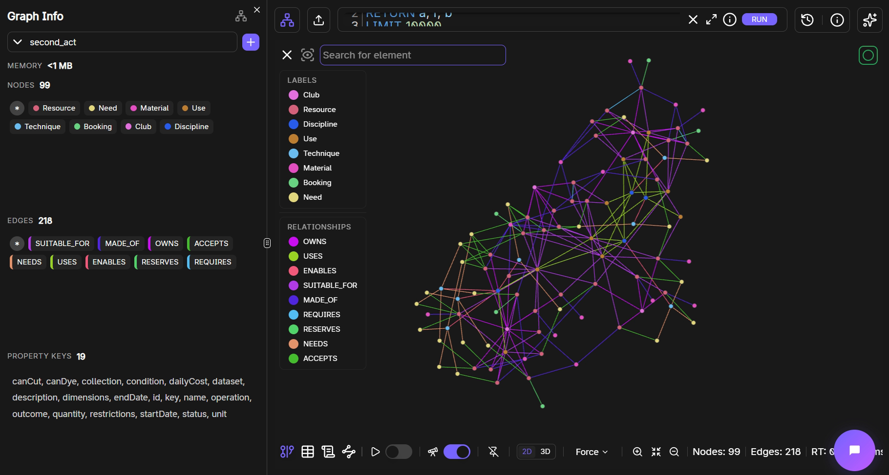

# SecondAct

A pop-art creative planning app for artists working with limited resources. Choose filmmaking, theatre, photography or fashion design; describe an idea, materials, budget and dates; then get a Gemini plan grounded in a live FalkorDB inventory.

## Live website

https://secondact.pages.dev/

The frontend is hosted on Cloudflare Pages Free, connected to AWS Lambda in Mumbai and the existing Gemini and FalkorDB services. A shared daily planning limit helps control usage. See [AWS deployment and budget notes](AWS-DEPLOYMENT.md).

## Demo video

[Watch the SecondAct project demo on YouTube](https://youtu.be/wJ3xYby5KnM).

## Run locally

Requires Node.js 22.9+ and a reachable FalkorDB instance.

1. In the backend folder, run `npm ci --ignore-scripts`.
2. Copy `backend/.env.example` to `backend/.env` and supply your database connection, password and Gemini key. Never commit this private file.
3. Run `npm run seed` from the backend folder to create the fictional demo inventory.
4. Run `npm start` and open http://127.0.0.1:4318/.

`GEMINI_MODEL` is configurable. The fashion demo was verified with `gemini-3.5-flash-lite`; choose a model available to your API project. Manual inventory search works without a Gemini key. Cloud connectivity and available provider quota are required for their respective services.

## What SecondAct does

- Turns a creative brief into production steps, resource choices, inventory costs, assumptions and unresolved needs. Gemini chooses tools and uses live FalkorDB results to build the plan.
- Finds resources and alternatives by purpose, dates, quantity and budget, including required-equipment checks.
- Explains recommendations through **Why these choices?**, with the actual tool trace and graph paths.
- Checks fashion making methods against their required supplies, booked tools and cutting or dyeing permissions.
- Supports filmmaking, theatre, photography and fashion design, with a ready-to-use demo brief for each world.
- Saves profiles and briefs on the device, with profile editing and logout.
- Provides responsive layouts, keyboard shortcuts, reduced-motion support and a skippable curtain-and-spotlights intro.

## Why FalkorDB is central

FalkorDB stores 35 fictional resources, creative uses, owning clubs, materials, five bookings, three equipment dependencies and seven making techniques. Technique paths connect mandatory needs to alternative resources and enforce cut/dye permissions. Fashion planning starts by inspecting these methods and verifies that selected supplies cover every required need. Searches follow connected uses to find suitable resources and alternatives. A camera body is rejected as an available kit when its required lens is booked. The backend calculates stock throughout the requested dates and verifies the combined plan cost. If the graph is unavailable, inventory queries fail instead of substituting a hard-coded answer.

### Start with the backdrop example

The blue backdrop fabric is booked for the project dates. SecondAct follows its shared **Backdrop** use to find teal curtains as an alternative, then checks their availability, quantity, cost and borrowing rules before recommending them.

Blue backdrop fabric **—SUITABLE_FOR→** Backdrop **←SUITABLE_FOR—** Teal curtain pair.

The connection explains why curtains are considered; the availability and cost checks determine whether they can be used. The inventory is fictional demo data, queried from the actual FalkorDB graph.

### Graph data model

Nodes represent creative disciplines, making techniques, requirements, resources, uses, materials, clubs and bookings. The named edges below are the relationships queried by the backend.



**Actual FalkorDB graph — fictional demo inventory.** Extracted from our FalkorDB Browser recording, showing 99 nodes and 218 relationships in 2D. Browser tabs, the address bar and connection details have been cropped out.

| From | Relationship | To |
| --- | --- | --- |
| Discipline | USES | Use |
| Resource | SUITABLE_FOR | Use |
| Club | OWNS | Resource |
| Resource | MADE_OF | Material |
| Booking | RESERVES | Resource |
| Resource | REQUIRES | Resource |
| Discipline | ENABLES | Technique |
| Technique | NEEDS | Need |
| Need | ACCEPTS | Resource |

**A real path in the fashion demo:**

Fashion design **—ENABLES→** Hand-sewn peacock appliqué **—NEEDS→** Cuttable motif fabric **—ACCEPTS→** Teal peacock-motif offcuts.

For October 25–27, 2026, the demo sewing machine is booked, so machine sewing is rejected. Borrowed fabric without cutting permission is also rejected for a cuttable motif. The hand-sewn method and permitted teal offcuts remain usable options. Gemini builds its plan from these checked graph results; the backend also validates stock, required equipment and the combined resource cost.

See [the graph data model](backend/GRAPH-MODEL.md), [the Cypher search queries](backend/search.mjs), and [backend setup and API details](backend/README.md).

## Try an example

Click a creative world to open its project page. Use **Fill with demo brief**, above the project-name input, then **Make my creative plan**. The loading overlay clears when results arrive and the page moves to the plan.

**Photography:** the demo fills a ₹500 portrait brief for **October 25–27, 2026**, demonstrating booked blue fabric and graph-connected backdrop alternatives. The manual **Try the backdrop demo** also exposes these availability checks without an AI call.

**Fashion Designer:** the demo fills **Rajput Queen dress**, a peacock-inspired costume, the artist's own base garment and design, a ₹2,000 budget, and **October 25–27, 2026**. The sewing machine and embroidery hoops are booked on these dates. Inspect the hand-sewn alternatives, alteration permissions, resource bill and graph connections. AI wording and choices can vary.

## Validation

Run from the backend folder:

```text
npm test                  # deterministic stock and plan-validation tests
npm run check:db          # read-only database connection check
npm run check:inventory   # live resource, alternative and technique checks
npm run check:fashion     # live Gemini plan with graph-blocked machine sewing
npm run check:ai          # small Gemini generation check; consumes quota
npm run check:planner     # live Gemini + FalkorDB workflow; consumes quota
```

## Project layout

- `index.html`, `styles.css`: interface, responsive layout and animation.
- `app.js`: profiles, selection, brief persistence and manual inventory search.
- `planner.js`: submits and renders creative plans and graph evidence.
- `interactions.js`: input caret behavior and short selection-art animations.
- `intro-engine.js`, `intro.js`: stage choreography, playback and cleanup.
- `assets/`: six active image/brand assets only. See [asset notes](ASSETS.md).
- `backend/`: API server, database client, agent tools, graph seed, checks and tests. The lockfile is retained for reproducible installs.

Local recordings, the offline visual reference and archived design experiments belong in `extras/` and are excluded from Git. Credentials, installed dependencies and logs are also excluded.

## Prototype scope

Inventory, clubs and bookings are fictional. Profiles and briefs are stored in the browser; there is no production authentication, cloud project storage, persistent graph-based agent memory or real borrowing transaction. Plans check availability but do not reserve resources. Resource totals exclude unpriced needs such as travel, consumables and externally sourced embellishments. The backend sends the brief and relevant fictional inventory to Gemini, without the local profile. The public AWS deployment is documented in [AWS-DEPLOYMENT.md](AWS-DEPLOYMENT.md); a fresh checkout can also run locally using the instructions above.
