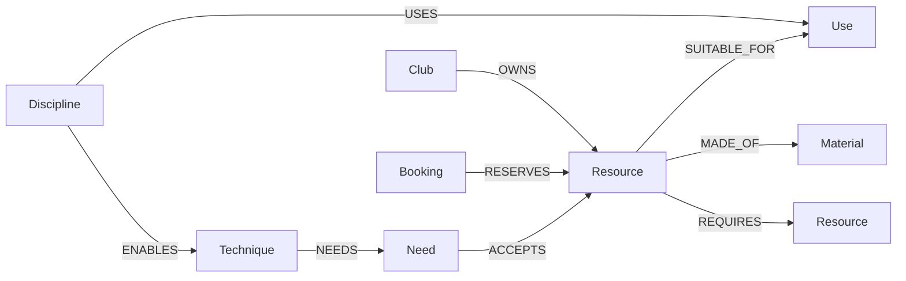

# SecondAct demo graph

Graph name: `second_act`, unless changed in private configuration.
Dataset namespace: `second-act-demo-v1`.



## What is stored

- Four creative disciplines and their supported uses.
- Thirty-five resources with stock quantities, daily borrowing costs in INR, dimensions, descriptions and restrictions.
- Four fictional owning clubs and collection notes.
- Materials, linked to resources.
- Five confirmed sample bookings, with inclusive start/end dates and quantities.
- Three equipment requirements: camera/lens, tripod/phone mount and projector/screen.
- Seven making techniques with mandatory needs and alternative resources; four are fashion techniques.
- Explicit canCut/canDye permissions on every resource.

No user profile, password, personal contact details or actual institution data is seeded.

## How it changes the product

Resource search follows Discipline → Use ← Resource ← Club and reads material and booking relationships. The server calculates the maximum concurrent reservation quantity across the selected days to find stock available throughout the requested period.

Alternative search begins with an existing resource and follows Resource → Use ← Alternative Resource, constrained to the selected discipline. Replacements are checked against the same dates, quantities and budget.

Before recommending the camera, a second graph query follows its REQUIRES relationship to the compatible lens. A booked lens makes the kit unavailable. The lens cost is included in the camera result's total borrowing cost.

The live API does not substitute a local inventory if FalkorDB fails: it returns an unavailable-inventory response. The local data module is used only to seed and describe this fictional demo; search results and availability come from the live graph.

## Files

- `demo-data.mjs`: fictional sample content and stable IDs.
- `seed.mjs`: idempotent, parameterised graph writes.
- `search.mjs`: parameterised resource, alternative and requirement queries.
- `availability.mjs`: input validation and stock calculations.
- `check-inventory.mjs`: read-only integration checks against the connected graph.

## Agent tools

`planner.mjs` lets Gemini inspect making techniques, choose creative uses for `search_resources`, follow `find_alternatives`, and submit `finish_plan`. Its final resource IDs must have appeared in the graph results in the current request. The server checks aggregate stock and total cost before accepting the plan. The UI presents the tool trace and graph-path explanations. No agent memory or project records are written to the graph yet.

## Technique reasoning

The parameterized query in techniques.mjs follows Discipline → ENABLES → Technique → NEEDS → Need → ACCEPTS → Resource. Every need must be met; the ACCEPTS edges are alternative options, not an instruction to borrow all of them. The live resource queries provide date availability, required-equipment checks and costs. A cut or dye operation rejects any resource without the corresponding explicit permission. Final selected techniques must have been inspected, be available, and have a permitted selected resource for every need. The combined resource budget is validated at completion; an available method may still exceed the budget. Only listed shared stock counts toward these verified technique needs; personal skills, the base garment and creative suitability remain assumptions.

Fashion must inspect methods on its first agent turn. The browser displays the selected methods and their actual resource paths, and the evidence panel includes rejected methods and alteration restrictions. Other disciplines can inspect their connected setup methods too.

### Repeatable demo

Use fashion on 2026-10-25 through 2026-10-27: the sewing machine and both embroidery hoops are booked. Machine appliqué and hoop-based embroidery are blocked; hand appliqué and removable draping remain possible. Blue borrowed fabric is rejected for a cuttable motif even when it is free. On 2026-10-28 through 2026-10-30, the machine and hoops are available again. No bookings are modified by the checks. All stock, prices and methods are fictional examples, not verified suppliers or historical costume expertise.

### Explore in FalkorDB Browser

Select second_act and run:

```cypher
MATCH (d:Discipline {key:'fashion'})-[a:ENABLES]->(t:Technique)-[b:NEEDS]->(n:Need)-[c:ACCEPTS]->(r:Resource)
RETURN d,a,t,b,n,c,r
```
