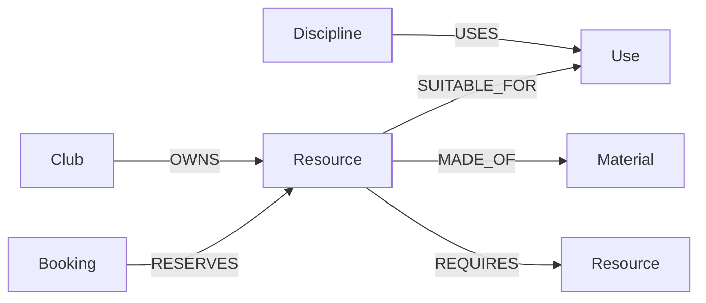

# Second Act demo graph

Graph name: `second_act`, unless changed in private configuration.
Dataset namespace: `second-act-demo-v1`.

## What is stored

- Four creative disciplines and their supported uses.
- Ten resources with stock quantities, daily borrowing costs in INR, dimensions, descriptions and restrictions.
- Four fictional owning clubs and collection notes.
- Materials, linked to resources.
- Three confirmed sample bookings, with inclusive start/end dates and quantities.
- One camera-body-to-compatible-lens requirement.

No user profile, password, personal contact details or actual institution data is seeded.

## How it changes the product

Resource search follows Discipline → Use ← Resource ← Club and reads material and booking relationships. The server calculates the maximum concurrent reservation quantity across the selected days to find stock available throughout the requested period.

Alternative search begins with an existing resource and follows Resource → Use ← Alternative Resource, constrained to the selected discipline. Replacements are checked against the same dates, quantities and budget.

Before recommending the camera, a second graph query follows its REQUIRES relationship to the compatible lens. A booked lens makes the kit unavailable. The lens cost is included in the camera result's total borrowing cost.

The live API does not substitute a local inventory if FalkorDB fails: it returns an unavailable-inventory response. The local data module is used only to seed and describe this fictional demo; search results and availability come from the live graph.

## Files

- `demo-data.mjs`: fictional sample content and stable IDs.
- `seed.mjs`: idempotent, parameterised graph writes.
- `search.mjs`: parameterised resource, alternative and requirement queries.
- `availability.mjs`: input validation and stock calculations.
- `check-inventory.mjs`: read-only integration checks against the connected graph.

## Agent tools

`planner.mjs` lets Gemini choose creative uses for `search_resources`, follow `find_alternatives`, and submit `finish_plan`. Its final resource IDs must have appeared in the graph results in the current request. The server checks aggregate stock and total cost before accepting the plan. The UI presents the tool trace and graph-path explanations. No agent memory or project records are written to the graph yet.
